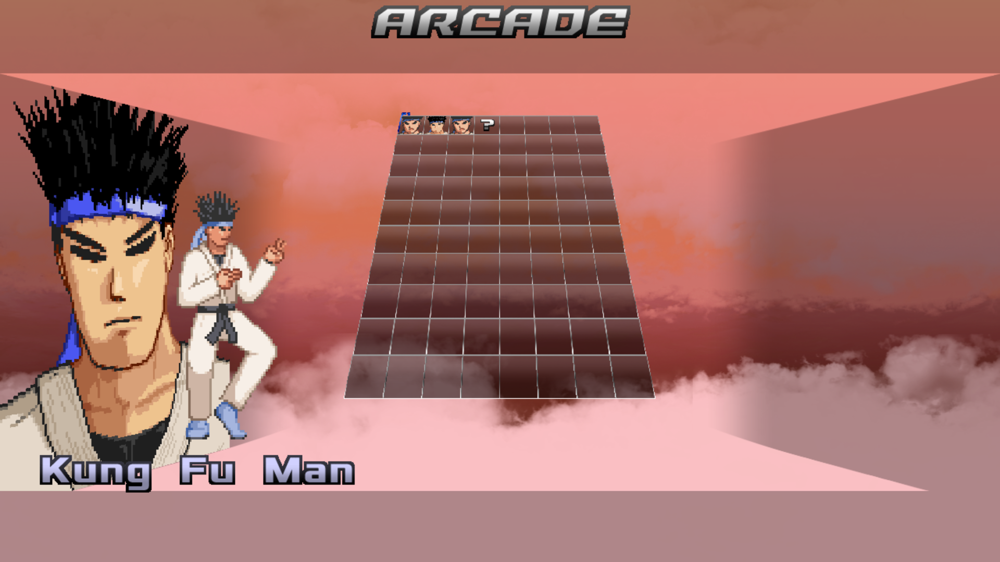

  

<h3 align="center">Game Vault · Ikemen GO</h3>

  <b>MUGEN fighting games on your Xbox, with the controller.</b> 
  The Ikemen GO engine for <a href="https://github.com/skitzellez/xbox-game-vault">Game Vault</a> on <b>Xbox Series X|S</b> in Dev Mode:
  pick a game in Game Vault and it plays here, then you are back in Game Vault.

<!-- gv-buttons:start -->

  
  &nbsp;
  
  &nbsp;
  
  &nbsp;
  

<!-- gv-buttons:end -->

  

## 🎮 What it is

[Ikemen GO](https://github.com/ikemen-engine/Ikemen-GO) is a free, open-source fighting game engine that plays MUGEN characters, stages and screenpacks. This app is that engine, made for Xbox Series X|S in Dev Mode.

**Only the free Kung Fu Man character and the default stages are included.** Bring your own MUGEN or Ikemen GO games, and only play games you have the right to play.

## 1️⃣ 2️⃣ 3️⃣ How to play

| | |
|---|---|
| **1** | Install [Game Vault](https://github.com/skitzellez/xbox-game-vault). Press RT in Game Vault to add this app with your phone. |
| **2** | Copy each MUGEN game as its own folder onto your games USB drive (the folder that has `chars`, `stages` and `data` in it). |
| **3** | Open the **MUGEN** shelf in Game Vault and press A. Quit from the game's pause menu to go back to Game Vault. |

The app saves its settings and progress inside the game's folder, so the drive needs room for that. exFAT drives work as they are.

## 📜 Credits and licence

This app is the work of many people. Thank you to all of them.

- **Ikemen GO:** © Suehiro, K4thos, NeatUnsou, ShinLucho, Daniel Porto, Gacel, Nikolay Griva and the [Ikemen GO team and contributors](https://github.com/ikemen-engine/Ikemen-GO/graphs/contributors). MIT, see [LICENSE](LICENSE).
- **First Windows app (UWP) port of Ikemen GO:** [worleydl](https://github.com/worleydl/Ikemen-GO-dev).
- **Xbox port this app is built from:** [danprice142](https://github.com/danprice142/Ikemen-GO-dev-uwp) (version 1.0.7.0).
- **Game Vault app and launch from Game Vault:** Skitzelles.
- **Other libraries and their licences** (SDL2, Mesa, FFmpeg, libxmp, the default screenpack): [licenses](licenses).

This is a modified build of Ikemen GO, not made or supported by the Ikemen GO team. Please report problems with this app to Game Vault, not to them.

<!-- gv-family:start -->
## 🎮 The Game Vault family

Game Vault is one launcher plus emulators built to work with it. **Install [Game Vault](https://github.com/skitzellez/xbox-game-vault) and it sets these up for you**; press **RT** in Game Vault to update them all.

**Apps**

| Project | What it is | Runs on |
|---|---|---|
| [Game Vault](https://github.com/skitzellez/xbox-game-vault) | The launcher: plug in a USB drive, pick a game, play. Sets up everything below by itself. | Xbox Series X&#124;S |
| [Game Vault for Android](https://github.com/skitzellez/game-vault-android) | The same game library for phones, tablets and Android TV (beta). | Android |
| [Game Vault for iPhone](https://github.com/skitzellez/game-vault-ios) | The Game Vault look on iPhone (early test). | iPhone |

**Emulators built for Game Vault**

| Project | What it is | Runs on |
|---|---|---|
| [xemu for Xbox Dev Mode](https://github.com/skitzellez/xemu-uwp) | Original Xbox | Xbox Series X&#124;S |
| [Xenia for Game Vault](https://github.com/skitzellez/Xenia-GameVault) | Xbox 360 | Xbox Series X&#124;S |
| [XBSX2 for Game Vault](https://github.com/skitzellez/XBSX2-GameVault) | PlayStation 2 | Xbox Series X&#124;S |
| [Dolphin for Game Vault](https://github.com/skitzellez/Dolphin-GameVault) | GameCube and Wii | Xbox Series X&#124;S |
| [Game Vault · Wii U (Cemu)](https://github.com/skitzellez/Cemu-GameVault) | Wii U | Xbox Series X&#124;S |
| [RPCS3 for Game Vault](https://github.com/skitzellez/RPCS3-GameVault) | PlayStation 3 | Xbox Series X&#124;S |
| [Game Vault · PS Vita](https://github.com/skitzellez/Vita-GameVault) | PlayStation Vita (Vitox / Vita3K) | Xbox Series X&#124;S |
| [Flycast for Game Vault](https://github.com/skitzellez/Flycast-GameVault) | Sega NAOMI, NAOMI 2 and Atomiswave arcade | Xbox Series X&#124;S |
| [RetroArch for Game Vault](https://github.com/skitzellez/RetroArch-GameVault) | PlayStation, Dreamcast, arcade, classic consoles and computers (80+ systems) | Xbox Series X&#124;S, Android |
| [PPSSPP for Game Vault](https://github.com/skitzellez/PPSSPP-GameVault) | PSP | Xbox Series X&#124;S |
| [Game Vault · Ymir](https://github.com/skitzellez/Ymir-GameVault) | Sega Saturn | Xbox Series X&#124;S |
| [Game Vault · Azahar](https://github.com/skitzellez/Azahar-GameVault) | Nintendo 3DS | Xbox Series X&#124;S |
| [**Game Vault · Ikemen GO**](https://github.com/skitzellez/IkemenGO-GameVault) 📍 *you are here* | MUGEN fighting games | Xbox Series X&#124;S |
| [Game Vault · Visual Pinball](https://github.com/skitzellez/VPinball-GameVault) | Pinball tables | Xbox Series X&#124;S |
| [Supermodel for Game Vault](https://github.com/skitzellez/Supermodel-GameVault) | Sega Model 3 arcade (inside RetroArch) | Xbox Series X&#124;S |
| [Game Vault · Arcade](https://github.com/skitzellez/Arcade-GameVault) | Windows arcade games (early test) | Xbox Series X&#124;S |
| [Game Vault · Flash](https://github.com/skitzellez/Flash-GameVault) | Flash games | Xbox Series X&#124;S |
| [Game Vault · OpenBOR](https://github.com/skitzellez/OpenBOR-GameVault) | OpenBOR beat 'em up games | Xbox Series X&#124;S |
| [Gambatte for Game Vault](https://github.com/skitzellez/Gambatte-GameVault) | Game Boy link cable in online rooms | Xbox Series X&#124;S, Android |
| [X1 BOX for Game Vault](https://github.com/skitzellez/x1box-gamevault) | Original Xbox | Android |

**Extras**

| Project | What it is | Runs on |
|---|---|---|
| [gamevault.fyi](https://gamevault.fyi) | The Game Vault website | Any browser |
| [Compatibility list](https://skitzellez.github.io/game-vault-compatibility/) | How games run, from real player reports | Any browser |
| [Free games](https://github.com/skitzellez/game-vault-free-games) | Freeware and shareware for the FREE GAMES tab | Game Vault |
| [Game Vault · Web](https://github.com/skitzellez/Web-GameVault) | Websites from the WEB menu, with the controller | Xbox Series X&#124;S |
| [Fallout 1in2 for Xbox](https://github.com/skitzellez/Fallout1in2-Xbox) | The original Fallout, made for the controller | Xbox Series X&#124;S |
| [Game Vault updates](https://github.com/skitzellez/game-vault-updates) | Update data Game Vault reads when it starts | Game Vault |

**💬 Help, news and bug reports:** [gamevault.fyi](https://gamevault.fyi), the [Game Vault Discord](https://discord.gg/RmhhWgguvw) (or this repo's Issues).
Please don't take problems with these builds to the original emulator teams: they don't make or support them.
<!-- gv-family:end -->

## ❤️ Support the project

Game Vault and all of its emulator builds are free, and they always will be. No ads, no locked features,
nothing behind a paywall.

I build all of this with the help of an AI coding assistant (Claude), and that's what lets bug fixes and new features
come out so fast. If you'd like to help keep it going, you can support the project on
**[Patreon](https://www.patreon.com/Skitzelles)**. Every bit helps, and there's never any pressure.

**You help just as much by:**
- saying yes to **"Help make Game Vault better?"** in Game Vault. It sends crash reports, and that's how most fixes happen
- reporting problems on the **[Discord](https://discord.gg/RmhhWgguvw)**
- telling your friends and sharing your clips

Thank you for playing. 💙
